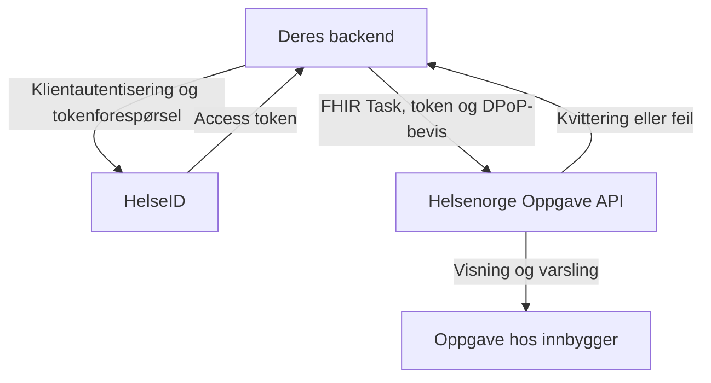
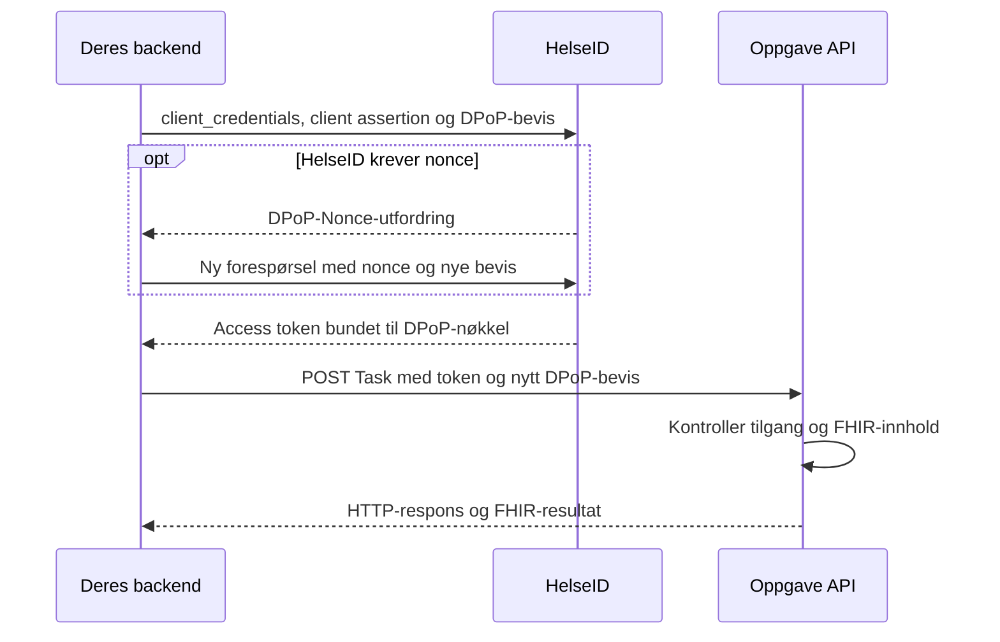

# HelseID: ekstern klient mot Helsenorge

**Utviklerguide med Oppgave API som eksempel**  
Faglig grunnlag kontrollert 11. november 2026.  
Målgruppe: utviklere hos en ekstern API-konsument. Kontekst: system-til-system.

## 1. Arkitektur og ansvar

**Deres backend henter et HelseID-token og sender en FHIR Task til Helsenorge.** Integrasjonen bruker `client_credentials` med DPoP. HelseID gir tilgangsbevis; oppgaveinnholdet sendes direkte til Oppgave API. [1], [2]

Scenarioet er et eksternt fagsystem som sender en informasjonsoppgave til en innbygger på vegne av en helsevirksomhet. Eksemplet gjelder konsumentsiden og kan implementeres uten Helsenorge-komponenter i eget system.



| Del | Ansvar |
| --- | --- |
| Deres backend | Lokal autorisasjon, FHIR-mapping, HelseID-klient, beskyttede nøkler, utsending, kvittering og feilhåndtering. |
| HelseID | Autentiserer klienten, kontrollerer tilganger og utsteder DPoP-bundet token. |
| Helsenorge Oppgave API | Kontrollerer tilgang og innhold, oppretter oppgaven og returnerer resultat. Endepunkt: `POST /oppgave/v1/Task`. |
| Helsenorge overfor innbygger | Håndterer visning, representasjon og varsling etter gjeldende regler. |

### Tre identiteter som må holdes atskilt

| Identitet | Betydning |
| --- | --- |
| Klient og virksomhet | HelseID-klienten og `orgnr_parent` angir hvem som kaller på vegne av hvem. [2], [8] |
| Innbygger | `Task.owner` identifiserer pasienten oppgaven gjelder. Dette er ikke en innlogget HelseID-bruker i denne flyten. [4] |
| Avsender i oppgaven | `Task.requester` beskriver avsenderen. FHIR-innhold gir i seg selv ingen API-rettighet. [2], [4] |

> **Også når helsepersonell utløser handlingen:** En behandler kan bestille oppgaven i deres system. Selve innsendingen til Oppgave API følger likevel dokumentert maskin-til-maskin-flyt. Lokal brukerautorisasjon og sporbarhet må ivaretas av dere. [1]

## 2. Tilgang, konfigurasjon og miljø

Avklar hvem klienten representerer før dere henter token.

### Oppstart i fire steg

1. **Avklar tjenesten.** Avtal brukstilfelle, helsevirksomhet, testpersoner og nettverksadgang med Helsenorge.
2. **Registrer klienten.** Opprett klientsystem og klientkonfigurasjon i HelseID Selvbetjening. Beskytt privatnøkkelen og registrer offentlig nøkkel. [9], [16]
3. **Søk API-tilgang.** Velg «Helsenorge Ekstern API» og scope «Oppgave». Tilgangen må godkjennes av Helsenorge. [1]
4. **Velg virksomhetsmodell.** Single-tenant: fast `orgnr_parent` fra registreringen. Multi-tenant: gyldig delegering og riktig helsevirksomhet for hvert tokenkall. [8]

### Konfigurasjon

| Konfigurasjon | Verdi eller regel |
| --- | --- |
| `client_id` og privatnøkkel | Bruk deres egen registrerte klient og nøkkel. Separate oppsett for test og produksjon. |
| Scope i kodeeksemplet | `nhn:helsenorge.eksternapi/Oppgave` |
| Forventet API-audience | `nhn:helsenorge.eksternapi` |
| `orgnr_parent` | Helseaktøren det sendes på vegne av. `orgnr_child` brukes bare ved avklart behov; verdien leveres av klienten. [8] |

De tekniske scope- og audience-strengene over er hentet fra testklientens konfigurasjon [14]. Bekreft dem mot deres godkjente oppsett i Selvbetjening. «Oppgave» er navnet i den offentlige tilgangsbeskrivelsen [1]. Audience er API-mottakeren i access tokenet.

### Baseadresser

| Miljø | Baseadresse for Oppgave API [3] |
| --- | --- |
| TEST02, internett | `https://eksternapi.hn2.test.nhn.no` |
| TEST01, internett | `https://eksternapi.hn.test.nhn.no` |
| Produksjon, Helsenett | `https://eksternapi-helsenett.helsenorge.no` |
| Produksjon, internett | `https://eksternapi.helsenorge.no` - bare der tilgjengelighet er avtalt for aktuelt API. |

HelseID issuer:

- Test: `https://helseid-sts.test.nhn.no`
- Produksjon: `https://helseid-sts.nhn.no`

Hent tokenendepunkt fra issuer + `/.well-known/openid-configuration`. All trafikk bruker HTTPS. [9], [12]

## 3. Token og DPoP gjennom hele kallet

Client assertion, access token og DPoP-bevis har forskjellige oppgaver. Bruk et klientbibliotek som følger HelseIDs sikkerhetsprofil. Det håndterer signering og protokollen; applikasjonen velger virksomhet, scope og API-operasjon. [9], [13]



| Bevis | Bruk i denne integrasjonen |
| --- | --- |
| Client assertion | Signeres med klientens registrerte nøkkel. Sendes til HelseID som `private_key_jwt`; ny ved hvert forsøk. `exp` maksimalt 10 sekunder frem i tid. [9] |
| Access token | Utstedes av HelseID for godkjente scopes og virksomhet. Kan mellomlagres frem mot utløp, basert på `expires_in`. [12] |
| DPoP-bevis | Nytt for hvert HTTP-kall. Binder token til nøkkel, metode og URL: blant annet `htm`, `htu`, `jti`, `iat` og `ath`. [10], [11] |

> **Token kan gjenbrukes. Beviset må være nytt.** Behold riktig DPoP-nøkkel sammen med tokenet. Skill cache per klient, virksomhet, miljø og scopes. Synkroniser klokken, og la biblioteket håndtere `DPoP-Nonce`. Bytte av virksomhet krever token for den nye konteksten. [8], [10], [11]

## 4. C# med NHNs klientbibliotek

Installer **HelseID.Library.ClientCredentials**. NHNs bibliotek har klientautentisering, tokenhenting og opprettelse av DPoP-bevis. Utdragene bygger på det dokumenterte API-et i kilderevisjonen fra 9. november 2026. [13]

Utdragene skal tilpasses deres backend. Ingen hemmeligheter skal ligge i kildekoden.

```csharp
var configuration = new HelseIdConfiguration
{
    ClientId = cfg.ClientId,
    Scope = cfg.OppgaveScope,
    IssuerUri = cfg.HelseIdIssuer
};

builder.Services.AddHelseIdClientCredentials(configuration)
    .AddJwkForClientAuthentication(privateJwkFromSecretStore);
```

Bruk dependency injection for `IHelseIdClientCredentialsFlow` (`flow`), `IDPoPProofCreatorForApiRequests` (`proofs`) og `HttpClient`. Variablene `cfg`, `taskJson` og `ct` leveres av applikasjonen.

```csharp
var result = await flow.GetTokenResponseAsync();
if (!result.IsSuccessful(out var token))
    throw new InvalidOperationException("Tokenkallet feilet");

var granted = token.Scope.Split(
    ' ', StringSplitOptions.RemoveEmptyEntries);
if (!granted.Contains(cfg.OppgaveScope))
    throw new InvalidOperationException("Mangler scope");

var url = cfg.ApiBaseUrl.TrimEnd('/') + "/oppgave/v1/Task";
var proof = await proofs.CreateDPoPProofForApiRequest(
    HttpMethod.Post, url, token);

using var request = new HttpRequestMessage(HttpMethod.Post, url);
request.SetDPoPTokenAndProof(token, proof);
request.Headers.Accept.ParseAdd("application/fhir+json");
request.Content = new StringContent(
    taskJson, Encoding.UTF8, "application/fhir+json");

using var response = await httpClient.SendAsync(request, ct);
var body = await response.Content.ReadAsStringAsync(ct);

// Behandle status, headere og FHIR-body som beskrevet i avsnitt 6.
```

**Multi-tenant:** Bruk bibliotekets `OrganizationNumbers` og `GetTokenResponseAsync(organizationNumbers)`. `ParentOrganization` skal være helsevirksomheten som har delegert til klienten; eventuell `ChildOrganization` må være korrekt. [8], [13]

**Produksjonskode:** Legg til token-cache, håndtering av tokenfeil, kontrollert retry og sikker lagring av kvitteringen. Opprett DPoP-beviset rett før sending. Ikke legg token eller DPoP-bevis i felles `DefaultRequestHeaders` på tvers av kall.

## 5. Konkret HTTP- og FHIR-eksempel

Informasjonsoppgave: innbygger skal lese informasjon før en avtale.

```http
POST https://eksternapi.hn2.test.nhn.no/oppgave/v1/Task
Authorization: DPoP <access_token>
DPoP: <nytt_signert_bevis_for_POST_og_denne_URLen>
Content-Type: application/fhir+json
Accept: application/fhir+json
```

JSON-malen under skal tilpasses. [4], [7] Erstatt plassholdere og velg riktig tjenesteområde. GUID, dato, lenke og avsendertekst er illustrasjoner. Eksemplet er ikke sendt til Helsenorge.

```json
{
  "resourceType": "Task",
  "meta": {
    "security": [
      {
        "system": "urn:oid:2.16.578.1.12.4.1.1.7618",
        "code": "VALGT_TJENESTEOMRADE"
      }
    ]
  },
  "identifier": [
    {
      "system": "urn:ietf:rfc:3986",
      "value": "urn:uuid:5dab4b1c-42a8-430f-8763-d9339cd2bc13"
    }
  ],
  "status": "ready",
  "intent": "proposal",
  "code": {
    "text": "Les informasjon før avtalen"
  },
  "description": "Les hvordan du kan forberede deg til timen.",
  "focus": {
    "type": "Communication"
  },
  "instantiatesUri": "https://example.org/forberedelse",
  "owner": {
    "type": "Patient",
    "identifier": {
      "system": "urn:oid:2.16.578.1.12.4.1.4.1",
      "value": "DIN_SYNTETISKE_TESTPERSON"
    }
  },
  "requester": {
    "reference": "#avsender",
    "type": "Organization"
  },
  "contained": [
    {
      "resourceType": "Organization",
      "id": "avsender",
      "name": "Eksempelavdelingen",
      "contact": [
        {
          "purpose": {
            "text": "Kontakt avdelingen via avtalt kontaktkanal."
          }
        }
      ]
    }
  ],
  "restriction": {
    "period": {
      "end": "2027-06-01"
    }
  }
}
```

Vurder sensitiv avsender og øvrige metadata før bruk. `plan` velges bare når vilkårene i profilen er oppfylt. Behold samme `identifier` for samme logiske oppgave. `Task.id` fra Helsenorge lagres fra responsen. For skjema med vedlagt `Questionnaire` brukes eget Bundle-endepunkt. [1], [4], [5]

## 6. Kvittering, feil og ny sending

Gjør responsen til en eksplisitt del av integrasjonen.

### Ved vellykket opprettelse

Create-kontrakten beskriver HTTP `201 Created`, `Location` og opprettet ressurs med tildelt id. Lagre koblingen mellom deres `identifier` og returnert `Task.id`. Les FHIR-responstypen før parsing; dersom Task ligger i en Bundle, hentes den fra `entry.resource`. Verifiser nøyaktig responsform i integrasjonstesten. [5]

Lagre status, tidspunkt, eventuell `Location`, korrelasjons-ID og et beskyttet resultat av FHIR-parsingen. Et godkjent API-kall bekrefter mottak; det bekrefter ikke at varsel er levert eller at innbygger har lest innholdet.

### Feilhåndtering

| Observasjon | Hva klienten bør gjøre |
| --- | --- |
| Tokenkallet feiler | Kontroller klient, nøkkel, klokke, scopes, delegering og virksomhet. Les HelseIDs feilrespons og `rejected_scope` ved behov. [12] |
| HTTP 401 / 403 | Undersøk token, DPoP og tilgang. Helsenorge dokumenterer også 403 ved utløpt access token; statuskoden alene skiller derfor ikke årsakene. [2] |
| HTTP 400 + `OperationOutcome` | Les `issue`-feltene og feilkode. Rett innhold eller forretningsforutsetning før ny sending. [5], [6] |
| 002118 / 2118 | Innbygger er ikke digitalt aktiv for aktuelt tjenesteområde. Dette løses ikke ved å hente et nytt HelseID-token. [6] |
| 002148 / duplikat | Samme `Task.identifier` finnes allerede. Avstem mot tidligere sending og lagret kvittering. [6] |
| Tidsavbrudd / brutt forbindelse | Utfallet kan være ukjent selv om klienten ikke fikk svar. Behold `identifier` og avklar om oppgaven ble opprettet før ny innsending. |
| HTTP 429 / 5xx, hvis mottatt | Bruk avgrenset retry med ventetid og eventuell `Retry-After`. For POST må ukjent utfall håndteres før gjentakelse. |

**Anbefalt lokalt mønster:** Lagre bestillingen varig før sending, og før tilstandene «klar», «sendes», «bekreftet», «avvist» og «ukjent utfall». En stabil `identifier` og duplikatfeil er ikke i seg selv en garanti for idempotent HTTP-behandling.

For en informasjonsoppgave setter Helsenorge status til `completed` ved første uthopp. Det eksterne informasjonsnettstedet skal ikke selv melde denne oppgaven fullført. [7]

## 7. Fra første test til produksjon

Bruk punktene som agenda i dialogen med utvikleren.

| Kontroll | Hva dere skal kunne demonstrere |
| --- | --- |
| Tilgang og virksomhet | Klient og Oppgave-scope er godkjent. Rett helsevirksomhet brukes ved alle kall; eventuell delegering er på plass. |
| Sikkerhet i transporten | Token hentes med registrert nøkkel. `Authorization`- og `DPoP`-headeren følger kallet. Feil scope, virksomhet, nøkkel, URL og gammelt bevis blir avvist. |
| Helsenorge-funksjonen | En avtalt syntetisk testperson kan motta oppgaven. Tittel, avsender, frist, tjenesteområde og lenke vises som ønsket. |
| Kvittering og feil | 201-respons og `Task.id` lagres. `OperationOutcome` håndteres. Test 2118, duplikat, tokenutløp og ukjent utfall ved tidsavbrudd. |
| Drift | Nøkkelrotasjon, utløpsvarsler, klokkesynkronisering, overvåking og rutiner for manuell avstemming er etablert. |
| Produksjonssetting | Egne produksjonsverdier og tilgang er bekreftet. Nettverksvei til Oppgave API er avklart. Persondata og tokens beskyttes i logger og feilmeldinger. |

### Kode dere kan starte med

**[NHNs HelseID.Library][13]**  
Offisielt klientbibliotek for .NET og `client_credentials`. Bruk README samt dokumentasjonen for token requests, DPoP og secrets.

**[Informasjonsoppgave-testklienten][14]**  
Uavhengig demo med Node.js og .NET. Viser oppgavebygging, HelseID-integrasjon og responsbehandling. Er et kodeeksempel, ikke en godkjenning fra NHN.

**[Test-token-tjenesten, TTT][15]**  
Kan brukes til tidlig prøving i test med riktig oppsett og tilgang. Planlegg også ende-til-ende-test med egen registrert HelseID-klient før produksjon.

### Avklar dette i første utviklersamtale

- Hvilken virksomhet representerer klienten?
- Hvem forvalter nøklene?
- Hvilket testmiljø og hvilke testpersoner brukes?
- Hvordan håndteres ukjent utfall?
- Hvem verifiserer at oppgaven faktisk vises riktig hos innbygger?

## 8. Kilder og avgrensninger

Offisiell NHN- og Helsenorge-dokumentasjon er grunnlaget. Konfigurasjonsstrenger fra den uavhengige testklienten er særskilt merket. Lokalt driftsmønster og testliste er anbefalinger for egen implementasjon.

1. [Oppgave API][1] - Tilgang, scope i Selvbetjening og endepunktene Task/Bundle.
2. [Helsenorge API i systemkontekst][2] - Maskin-til-maskin, virksomhet, DPoP og utløpt token.
3. [Testmiljøer og endepunkter][3] - Baseadresser, nettverk og tilgjengelighet.
4. [FHIR Task - Oppgave][4] - Gjeldende Helsenorge-profil og betingede felt.
5. [FHIR - REST-operasjoner][5] - Opprettelse, ressursidentitet og HTTP-respons.
6. [Feilsituasjoner og feilkoder][6] - Validering, duplikater og digital aktivitet.
7. [Informasjonsoppgave][7] - Communication, informasjonslenke og fullføring.
8. [HelseID: organisasjonsnumre][8] - Single-tenant, multi-tenant og representert virksomhet.
9. [HelseID: sikkerhetskrav][9] - Klientautentisering, nøkler og transport.
10. [HelseID: bruk av DPoP][10] - Nøkkelbinding og nonce ved tokenhenting.
11. [HelseID: validering av DPoP-bevis][11] - Metode, URL, tid, engangsbruk og hash av token.
12. [HelseID: token-endepunktet][12] - Parametre, scopes og tokenrespons.
13. [NHN: HelseID.Library][13] - README og `Documentation/ClientCredentialsUsage`. Kodegrunnlag 9. november 2026.
14. [Informasjonsoppgave-testklient][14] - Uavhengig demo: miljøvariabler, FHIR-mapping og transport.
15. [NHN: Test-token-tjenesten][15] - TTT er et testhjelpemiddel med egne vilkår og testdata.
16. [HelseID Selvbetjening][16] - Registrering av klientsystem og klientkonfigurasjon.

**Status på eksemplene:** C# er dokumentasjonsutdrag, ikke et ferdig, kompilert prosjekt. JSON er en mal med plassholdere, ikke en ferdig validert melding. Det er ikke utført tokenhenting eller API-kall som del av denne veiledningen.

For andre Helsenorge-API-er brukes samme sikkerhetsmønster bare der API-kontrakten beskriver systemkontekst. Scope, endepunkt, payload og virksomhetskrav må avklares for det enkelte API. Innbyggerinnlogging og personlige brukerrettigheter har egne integrasjonsløp.

[1]: https://helsenorge.atlassian.net/wiki/spaces/HELSENORGE/pages/2109734913
[2]: https://helsenorge.atlassian.net/wiki/spaces/HELSENORGE/pages/1886191617
[3]: https://helsenorge.atlassian.net/wiki/spaces/HELSENORGE/pages/1552384092
[4]: https://helsenorge.atlassian.net/wiki/spaces/HELSENORGE/pages/742948883
[5]: https://helsenorge.atlassian.net/wiki/spaces/HELSENORGE/pages/1254654012
[6]: https://helsenorge.atlassian.net/wiki/spaces/HELSENORGE/pages/1979777036
[7]: https://helsenorge.atlassian.net/wiki/spaces/HELSENORGE/pages/2619211802
[8]: https://utviklerportal.nhn.no/informasjonstjenester/helseid/bruksmoenstre-og-eksempelkode/bruk-av-helseid/docs/tekniske-mekanismer/organisasjonsnumre_no_nbmd
[9]: https://utviklerportal.nhn.no/informasjonstjenester/helseid/protokoller-og-sikkerhetsprofil/sikkerhetsprofil/docs/sikkerhetskrav_no_nbmd
[10]: https://utviklerportal.nhn.no/informasjonstjenester/helseid/bruksmoenstre-og-eksempelkode/bruk-av-helseid/docs/dpop/dpop_no_nbmd
[11]: https://utviklerportal.nhn.no/informasjonstjenester/helseid/protokoller-og-sikkerhetsprofil/sikkerhetsprofil/docs/vedlegg/validering_av_dpop-bevis_no_nbmd/
[12]: https://utviklerportal.nhn.no/informasjonstjenester/helseid/bruksmoenstre-og-eksempelkode/bruk-av-helseid/docs/teknisk-referanse/endepunkt/token-endepunktet_no_nbmd
[13]: https://github.com/NorskHelsenett/HelseID.Library/tree/2ba3560fd5c157bf84ccefec3e960e06af7bd8e1
[14]: https://github.com/helgaarm/informasjons-oppgave-testklient
[15]: https://utviklerportal.nhn.no/informasjonstjenester/helseid/helseid-selvbetjening/test-token-tjenesten/docs/test-token-tjenesten_enmd
[16]: https://selvbetjening.nhn.no/docs
