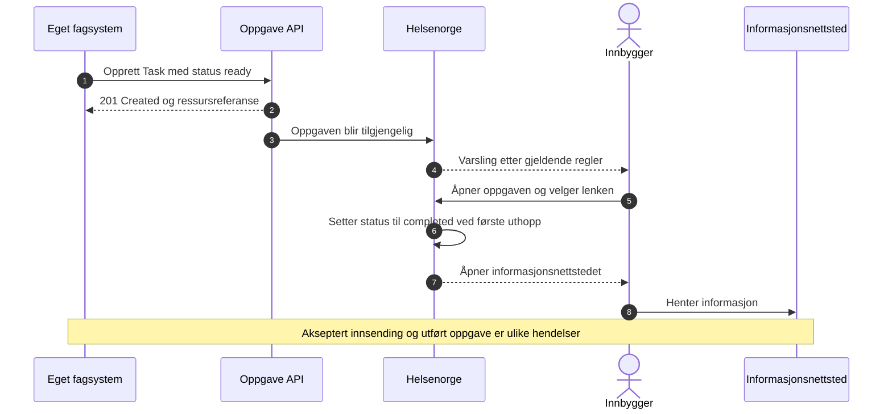
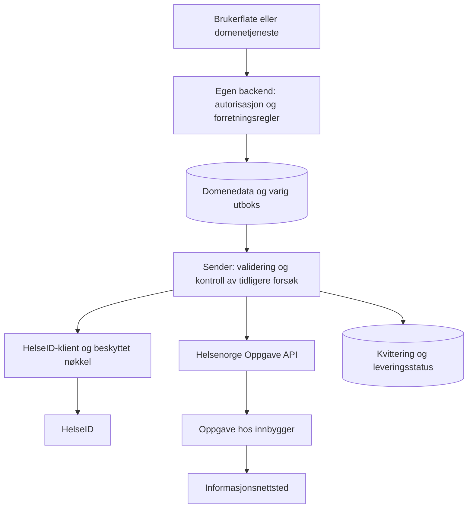
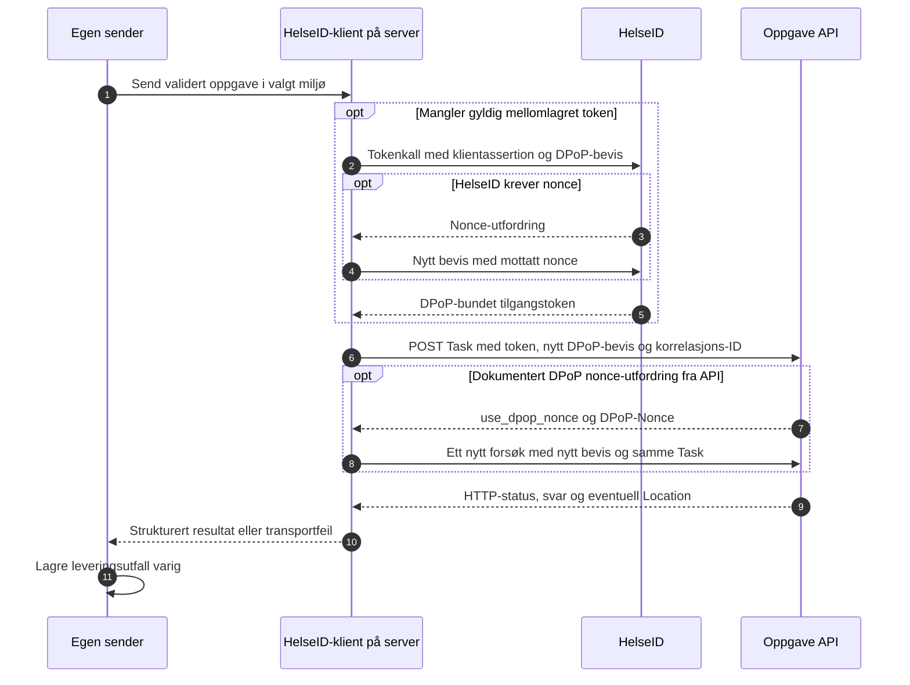
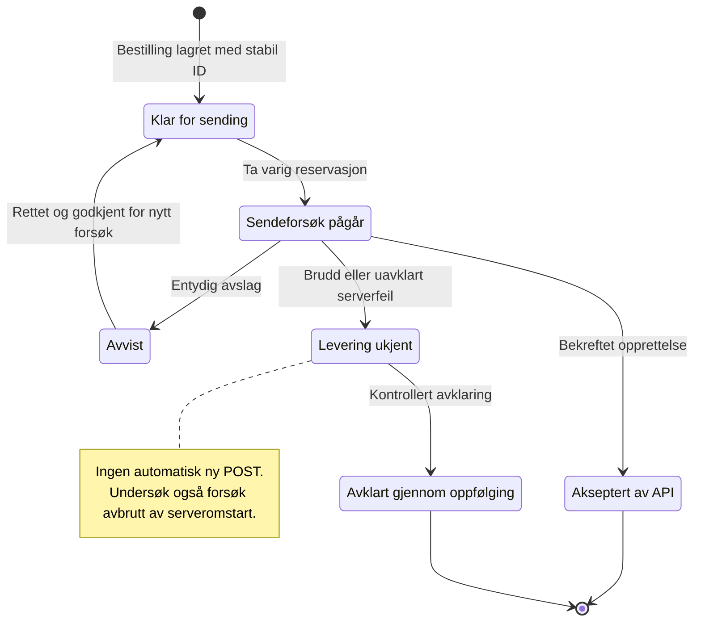

# Implementere informasjonsoppgaver i eget system

Denne veiledningen er for utviklere som vil bruke testklienten som kodeeksempel
for integrasjon med **Helsenorge Oppgave API**. Den viser hvordan en hendelse i
eget fagsystem kan bli til en informasjonsoppgave, og hvilke deler av koden som
kan gjenbrukes i en egen backend. Frontend kan bygges med valgfri teknologi.

Veiledningen er uavhengig av NHN. Offisielle krav og tilgangsavklaringer følger
[Oppgave API](https://helsenorge.atlassian.net/wiki/spaces/HELSENORGE/pages/2109734913)
og sidene det lenkes til underveis. Kildene er gjennomgått **26. oktober 2026**.
Arkitekturforslagene er våre anbefalinger; de er ikke en del av API-kontrakten.
Eksemplene er kontrollert lokalt med syntetiske data, ikke godkjent ved reell
innsending til Helsenorge.

For oppstart av selve testklienten: [Node-versjonen](../README.md) eller
[.NET-versjonen](../dotnet/README.md). Koden er [MIT-lisensiert](../LICENSE);
behold lisens- og opphavsrettsteksten ved viderebruk. Avhengigheter har egne lisenser.

## Innhold

- [1. Hva en informasjonsoppgave gjør](#1-hva-en-informasjonsoppgave-gjør)
- [2. Arkitektur i eget system](#2-arkitektur-i-eget-system)
- [3. Fra domenedata til FHIR Task](#3-fra-domenedata-til-fhir-task)
- [4. Bygg oppgaven i C# eller Node.js](#4-bygg-oppgaven-i-c-eller-nodejs)
- [5. HelseID og innsending](#5-helseid-og-innsending)
- [6. Kvittering, feil og ukjent levering](#6-kvittering-feil-og-ukjent-levering)
- [7. Innhold, representasjon og senere endringer](#7-innhold-representasjon-og-senere-endringer)
- [8. Finn frem i kildekoden](#8-finn-frem-i-kildekoden)
- [9. Fra kodeeksempel til egen integrasjon](#9-fra-kodeeksempel-til-egen-integrasjon)
- [10. Videre lesning](#10-videre-lesning)

## 1. Hva en informasjonsoppgave gjør

En informasjonsoppgave gir innbygger en lenke til relevant informasjon. Oppgaven
har `focus.type = Communication`, og nettadressen ligger i `instantiatesUri`.
Helsenorge setter oppgaven til utført ved første uthopp; innbygger kan fortsatt
besøke innholdet senere. Nettsiden skal ikke selv melde oppgaven fullført.
[Offisiell beskrivelse av informasjonsoppgaver](https://helsenorge.atlassian.net/wiki/spaces/HELSENORGE/pages/2619211802).

Et praktisk eksempel er informasjon før en avtale: Fagsystemet velger mottaker,
innhold og frist, mens integrasjonen oppretter oppgaven. Informasjonsnettsiden
må fortsatt fungere hvis avtaletidspunktet flyttes eller innholdet endres.



**Tre forskjellige observasjoner:** HTTP-kvitteringen gjelder innsendingen,
`Task.status` gjelder oppgaven i Helsenorge, og eventuell dokumentasjon av at
informasjon er lest eller forstått krever en egen faglig avklaring. Ikke bruk
første uthopp som bevis på lesing eller samtykke.

## 2. Arkitektur i eget system

Vi anbefaler at oppgavebygging, tilgangsstyring og innsending ligger på serveren.
En varig utboks (*outbox*) kan lagre en bestilling sammen med hendelsen som
utløste den. En bakgrunnsjobb sender først etter lokal validering og registrerer
utfallet. Dette er et arkitekturforslag for eget system; testklienten har ikke
database, varig utboks eller bakgrunnsutsending.



La domenetjenesten bestemme at en informasjonsoppgave skal opprettes; la en egen
mapper bestemme FHIR-strukturen. Da kan tittel, frist og lenke testes uten
nettverk, og transporten testes uten å hente ekte personopplysninger.

Hold tre identiteter adskilt:

| Identitet | Betydning i løsningen |
| --- | --- |
| Operatør eller utløsende tjeneste | Hvem eget system tillater å bestille oppgaven. Må autoriseres lokalt. |
| API-klient og virksomhet | Hvem HelseID-tokenet representerer overfor Helsenorge. |
| Mottaker i `owner` | Innbyggeren oppgaven gjelder, også når noen representerer vedkommende. |

HelseID maskin-til-maskin erstatter ikke operatørinnlogging i eget system.
`requester` beskriver avsenderen i oppgaven; navnet eller et organisasjonsnummer
i payload gir ikke API-tilgang. Virksomhetskonteksten må også være riktig i
tokenet. [Systemkontekst og HelseID](https://helsenorge.atlassian.net/wiki/spaces/HELSENORGE/pages/1886191617).

## 3. Fra domenedata til FHIR Task

Feltutvalget nedenfor viser hvordan dette repoet bygger en informasjonsoppgave.
Bruk [FHIR Task – Oppgave](https://helsenorge.atlassian.net/wiki/spaces/HELSENORGE/pages/742948883)
som referanse for hele kontrakten, betingede felt og gjeldende begrensninger.

| Domenedata | FHIR-felt i eksemplet |
| --- | --- |
| Stabil oppgaveidentifikator | `identifier`: UUID med system `urn:ietf:rfc:3986` |
| Ny oppgave | `status: ready` |
| Frivillig påminnelse / direkte helsehjelp | `intent: proposal` / `plan` |
| Tittel og forklaring | `code.text` og `description` |
| Informasjonstype og nettadresse | `focus.type: Communication` og `instantiatesUri` |
| Innbygger | `owner.type: Patient` og `owner.identifier` |
| Avsender | `requester` peker til `Organization` i `contained` |
| Svarfrist | `restriction.period.end` |
| Tilgangsområde | `meta.security` med kodeverk 7618 |

UUID-en opprettes én gang for den logiske oppgaven og lagres i eget system.
Ikke lag en ny UUID for hvert teknisk sendeforsøk. Skill den fra `Task.id`, som
Helsenorge tildeler ved POST, og fra korrelasjons-ID for det enkelte HTTP-kallet.
[FHIR REST-operasjoner](https://helsenorge.atlassian.net/wiki/spaces/HELSENORGE/pages/1254654012).

Denne JSON-malen er til lesing og tilpasning. `DIN_TESTPERSON` og
`VALGT_TJENESTEOMRADE` må erstattes med egne avklarte testverdier før validering.
UUID, avsendertekst, eksempeladresse og dato er illustrasjoner; de skal ikke
gjenbrukes som identitet eller innhold i faktiske oppgaver.

```json
{
  "resourceType": "Task",
  "meta": {
    "security": [
      {
        "system": "urn:oid:2.16.578.1.12.4.1.1.7618",
        "code": "VALGT_TJENESTEOMRADE"
      }
    ]
  },
  "identifier": [
    {
      "system": "urn:ietf:rfc:3986",
      "value": "urn:uuid:edaa7e3b-d158-47f2-b6c9-76308d4ad49a"
    }
  ],
  "status": "ready",
  "intent": "proposal",
  "code": { "text": "Les informasjon før avtalen" },
  "description": "Les om hvordan du kan forberede deg. Kontakt avdelingen hvis du har spørsmål.",
  "focus": { "type": "Communication" },
  "instantiatesUri": "https://example.org/informasjon/forberedelse",
  "owner": {
    "type": "Patient",
    "identifier": {
      "system": "urn:oid:2.16.578.1.12.4.1.4.1",
      "value": "DIN_TESTPERSON"
    }
  },
  "requester": { "reference": "#sender", "type": "Organization" },
  "contained": [
    {
      "resourceType": "Organization",
      "id": "sender",
      "name": "Din avsenderenhet",
      "contact": [
        { "purpose": { "text": "Kontakt avdelingen via avtalt kontaktkanal." } }
      ]
    }
  ],
  "restriction": { "period": { "end": "2027-06-01" } }
}
```

For denne varianten sendes én `Task`. `Communication` i `focus.type` er
typeangivelsen; eksemplet oppretter ingen separat Communication-ressurs og
bruker ikke Bundle. Se [innsending av oppgaver](https://helsenorge.atlassian.net/wiki/spaces/HELSENORGE/pages/1806204934)
og [Oppgave API](https://helsenorge.atlassian.net/wiki/spaces/HELSENORGE/pages/2109734913).

## 4. Bygg oppgaven i C# eller Node.js

Funksjonene under viser samme mapping uten forhåndsvalgt testperson eller
virksomhet. Kall dem med data fra eget domene. Valider input og det ferdige
FHIR-objektet før lagring/innsending; funksjonene er ikke komplette
profilvalidatorer. De utfører ingen nettverkskall.

### C# med Firely

Eksemplet er skrevet for `Hl7.Fhir.R4` 6.8.0 og .NET 10, slik de brukes i
[API-prosjektet](../dotnet/src/Testklient.Api/Testklient.Api.csproj).
Aliaset `FhirTask` skiller ressursen fra .NETs asynkrone `Task`.

```csharp
using System.Globalization;
using Hl7.Fhir.Model;
using Hl7.Fhir.Serialization;
using FhirTask = Hl7.Fhir.Model.Task;

public static class InformationTaskExample
{
    public static FhirTask Build(
        Guid businessId,
        string recipient,
        string senderName,
        string title,
        string description,
        Uri informationUrl,
        DateOnly dueDate,
        string areaCode,
        bool sensitiveSender,
        FhirTask.TaskIntent intent)
    {
        if (businessId == Guid.Empty) throw new ArgumentException("Oppgi lagret oppgave-ID.");
        if (!informationUrl.IsAbsoluteUri || informationUrl.Scheme != "https"
            || informationUrl.UserInfo.Length > 0)
            throw new ArgumentException("Bruk en kontrollert HTTPS-adresse uten brukerinformasjon.");
        if (intent is not (FhirTask.TaskIntent.Proposal or FhirTask.TaskIntent.Plan))
            throw new ArgumentException("Velg proposal eller plan ut fra behovet.");

        var task = new FhirTask
        {
            Identifier = [new Identifier("urn:ietf:rfc:3986", $"urn:uuid:{businessId:D}")],
            Status = FhirTask.TaskStatus.Ready,
            Intent = intent,
            Code = new CodeableConcept { Text = title },
            Description = description,
            Focus = new ResourceReference { Type = "Communication" },
            InstantiatesUri = informationUrl.AbsoluteUri,
            Owner = new ResourceReference
            {
                Type = "Patient",
                Identifier = new Identifier("urn:oid:2.16.578.1.12.4.1.4.1", recipient)
            },
            Requester = new ResourceReference { Reference = "#sender", Type = "Organization" },
            Contained = [new Organization { Id = "sender", Name = senderName }],
            Meta = new Meta
            {
                Security = [new Coding("urn:oid:2.16.578.1.12.4.1.1.7618", areaCode)]
            },
            Restriction = new FhirTask.RestrictionComponent
            {
                Period = new Period { End = dueDate.ToString("yyyy-MM-dd", CultureInfo.InvariantCulture) }
            }
        };
        if (sensitiveSender)
            task.Meta.Security.Add(new Coding("http://helsenorge.no/fhir/sensitiv-avsender", "1"));
        return task;
    }

    public static string ToJson(FhirTask task) => new FhirJsonSerializer().SerializeToString(task);
}
```

Bruk en FHIR-serializer for Firely-modellen. Vanlig serialisering av C#-objektet
er ikke en erstatning for FHIR JSON-formatet. Serialisering alene validerer
heller ikke oppgaven. [Firelys serialiseringsdokumentasjon](https://docs.fire.ly/projects/Firely-NET-SDK/en/latest/parsing/serialization.html).

### Node.js med repoets mapping og validator

Importstiene under gjelder en modul plassert i `docs/examples/` i dette repoet.
Ved overføring til eget system tilpasses stiene og avhengighetene. `newTask`
fyller inn grunnstrukturen; domenet bestemmer verdiene som overskrives.

```javascript
import { newTask, SYSTEMS } from '../../shared/task.js';
import { validateResource } from '../../server/fhir.js';

export function buildInformationTask({
  businessId, recipient, senderName, title, description,
  informationUrl, dueDate, areaCode, sensitiveSender, intent,
}) {
  if (!businessId) throw new Error('Oppgi lagret oppgave-ID.');
  const url = new URL(informationUrl);
  if (url.protocol !== 'https:' || url.username || url.password)
    throw new Error('Bruk en kontrollert HTTPS-adresse uten brukerinformasjon.');
  if (!['proposal', 'plan'].includes(intent)) throw new Error('Velg proposal eller plan.');

  const task = newTask(businessId);
  task.intent = intent;
  task.code.text = title;
  task.description = description;
  task.instantiatesUri = url.href;
  task.owner.identifier.value = recipient;
  task.requester.reference = '#sender';
  task.contained = [{ resourceType: 'Organization', id: 'sender', name: senderName }];
  task.meta.security = [{ system: SYSTEMS.area, code: areaCode }];
  if (sensitiveSender) task.meta.security.push({ system: SYSTEMS.sensitive, code: '1' });
  task.restriction.period.end = dueDate; // YYYY-MM-DD fra domenet

  const issues = validateResource(task);
  if (issues.some(issue => issue.severity === 'error'))
    return { valid: false, issues };
  return { valid: true, task, issues };
}
```

Her består kontrollen av repoets lokale Helsenorge-regler og `fhir-tool` sin
R4-strukturkontroll. .NET-serveren bruker tilsvarende lokale regler og Firely.
Ingen av dem gir full NHN-profil- eller terminologivalidering. Ta også hensyn til
at en importert ressurs kan ha extensions og felt utenfor eget standardskjema;
bevar dem ved redigering, og valider før sending.

## 5. HelseID og innsending

API-klienten må ha godkjent tilgang til Oppgave, riktig virksomhetskontekst og
et token for riktig API og miljø. Et vellykket tokenkall bekrefter ikke at
Helsenorge godtar klienten eller virksomheten. DPoP er påkrevd i systemkontekst.
[Helsenorges systemkontekst](https://helsenorge.atlassian.net/wiki/spaces/HELSENORGE/pages/1886191617)
og [Oppgave API](https://helsenorge.atlassian.net/wiki/spaces/HELSENORGE/pages/2109734913).

Repoet viser to måter å hente token på:

| Måte | Bruk i eksemplet |
| --- | --- |
| Registrert klient | `client_credentials` med `private_key_jwt` og DPoP. Klient, nøkkel og tilganger administreres gjennom HelseID. |
| Test-token-tjenesten, TTT | Testhjelpemiddel med egen API-nøkkel og midlertidig DPoP-nøkkel. Er ikke oppskriften for produksjonsautentisering. |

TTT-nøkkelen brukes bare mot Test-token-tjenesten; den skal aldri sendes til
Oppgave API. Bruk egen testvirksomhet som du har tilgang til. Ikke kopier en
annen brukers organisasjonsnummer, klient-ID eller nøkler.
[NHNs veiledning for TTT](https://utviklerportal.nhn.no/informasjonstjenester/helseid/helseid-selvbetjening/test-token-tjenesten/docs/test-token-tjenesten_enmd).

For registrert klient ser flyten slik ut. DPoP-beviset for API-kallet er et nytt
signert bevis, bundet til riktig HTTP-metode, URL og tilgangstoken. Nøkkelen må
svare til bindingen i tokenet. Se [NHNs DPoP-dokumentasjon](https://utviklerportal.nhn.no/informasjonstjenester/helseid/bruksmoenstre-og-eksempelkode/bruk-av-helseid/docs/dpop/dpop_no_nbmd)
for gjeldende format og nonce-håndtering.



Følgende verdier er konfigurert i **dette repoet**:

| Verdi | Konfigurasjon |
| --- | --- |
| Test01, opprett Task | `https://eksternapi.hn.test.nhn.no/oppgave/v1/Task` |
| Test02, opprett Task | `https://eksternapi.hn2.test.nhn.no/oppgave/v1/Task` |
| HelseID test, issuer | `https://helseid-sts.test.nhn.no` |
| Foreslått audience for TTT | `nhn:helsenorge.eksternapi` |
| Foreslått scope | `nhn:helsenorge.eksternapi/Oppgave` |

Bekreft miljø, audience, scope og tilgang for din integrasjon med NHN. Se
[testmiljøer og endepunkter](https://helsenorge.atlassian.net/wiki/spaces/HELSENORGE/pages/1552384092).
Testklientens miljøliste er fast og inneholder ikke produksjon. La heller ikke
en sluttbruker oppgi en vilkårlig URL som serveren sender tokenet til.

Et API-kall har denne formen; plassholderne er ikke reelle legitimasjoner:

```http
POST /oppgave/v1/Task HTTP/1.1
Host: eksternapi.hn2.test.nhn.no
Authorization: DPoP <tilgangstoken>
DPoP: <nytt-signert-bevis-for-dette-kallet>
Content-Type: application/fhir+json
Accept: application/fhir+json
X-Correlation-ID: <unik-id-for-http-kallet>

<FHIR Task som JSON, etter lokal validering>
```

Body er selve FHIR-ressursen. Testklientens lokale API tar i tillegg imot blant
annet valgt miljø og bekreftelse på testdata; denne lokale innpakningen er ikke
en del av Helsenorges API-kontrakt.

### Koble mapperen til repoets transportkode

Funksjonene under er små adaptere rundt repoets klienter, ikke et komplett
integrasjonsbibliotek. De krever at kalleren allerede har autorisert bestillingen
og tatt en varig reservasjon for oppgaven i riktig virksomhet og miljø. Kalleren
må også lagre resultat eller feil, inkludert ukjent levering. Det er ingen
automatisk gjentakelse i adapterne.

C#-eksemplet krever referanse til `dotnet/src/Testklient.Api` og en konfigurert
`IHelseIdClient`. I eget system kan de aktuelle klassene flyttes til en egen
integrasjonsmodul. Oppsettet finnes i `Configuration.cs` og `ConnectionSettings.cs`.

```csharp
using System.Text.Json.Nodes;
using Testklient;

public static class InformationTaskSender
{
    public static async Task<SubmissionResult> SendOnce(
        IHelseIdClient client, JsonNode task, string environmentId, string correlationId)
    {
        _ = Targets.Find(environmentId); // Kun repoets godkjente testendepunkter.
        var issues = new FhirService(TimeProvider.System).Validate(task);
        if (issues.Any(issue => issue.Severity == "error"))
            throw new ArgumentException("Oppgaven må rettes før sending.", nameof(task));

        return await client.SendTask(task, correlationId, environmentId);
    }
}
```

Node-eksemplet bruker samme importplassering som mapperen over. `client` er en
konfigurert `HelseIdClient` for registrert klient eller `TestTokenClient` for TTT.
Se `server/connection-settings.js` for valg av klient og serverkonfigurasjon.

```javascript
import { validateResource } from '../../server/fhir.js';
import { getTestEnvironment } from '../../shared/environments.js';

export async function sendOnce(client, task, environmentId, correlationId) {
  if (!getTestEnvironment(environmentId)) throw new Error('Velg et støttet testmiljø.');
  const issues = validateResource(task);
  if (issues.some(issue => issue.severity === 'error'))
    throw new Error('Oppgaven må rettes før sending.');
  return client.sendTask(task, correlationId, environmentId);
}
```

HelseID-klientklassene håndterer token, DPoP og HTTP. Den lokale appens sperre
mot dobbeltinnsending ligger rundt transportkallet, ikke i `SendTask`/`sendTask`.
Å kopiere transportklassen alene gir derfor ingen duplikatbeskyttelse.

## 6. Kvittering, feil og ukjent levering

Ved opprettelse beskriver API-et `201 Created`, ressursreferanse i `Location`
og ressursen i svaret. Lagre referansen sammen med din stabile oppgave-ID.
Dette er kvittering for opprettelsen, ikke for at innbygger har lest innholdet.
[FHIR REST-operasjoner](https://helsenorge.atlassian.net/wiki/spaces/HELSENORGE/pages/1254654012).

| Utfall | Anbefalt håndtering i eget system |
| --- | --- |
| Bekreftet opprettelse | Registrer akseptert levering, serverens ressurs-ID og kvittering. Stopp nye opprettelsesforsøk for samme bestilling. |
| Validerings- eller forretningsfeil | Les `OperationOutcome` når det finnes. Rett årsaken før et nytt, kontrollert forsøk. |
| `401` eller `403` | Undersøk token, DPoP, klienttilgang, virksomhet og miljø. Ikke løs det ved å endre mottaker eller lage ny oppgave-ID. |
| Duplikatmelding | Undersøk tidligere forsøk. Helsenorge dokumenterer `002148` for duplikat `Task.identifier`; meldingen alene er ikke en full kvittering. |
| Tidsavbrudd, nettverksbrudd etter sending, `408` eller `5xx` | Behandle som mulig levering. Stopp automatisk gjentakelse og avklar utfallet. |
| Feil før oppgaven ble sendt, for eksempel ved tokenhenting | Registrer at sending ikke startet. Vurder et avgrenset nytt forsøk etter at årsaken er løst. |

Feilkoder og forretningsavslag er beskrevet i
[Feilsituasjoner og feilkoder](https://helsenorge.atlassian.net/wiki/spaces/HELSENORGE/pages/1979777036).
Ikke alle feilsvar er FHIR; autentiseringsfeil kan også være OAuth-JSON eller
tekst. Presenter feilmeldinger som tekst og begrens størrelse og logging.

Denne tilstandsmodellen er et forslag for **lokal leveringsstatus**, ikke
verdier for `Task.status`:



Gi en databasebegrensning eller tilsvarende atomisk mekanisme ansvar for at to
arbeidere ikke sender samme bestilling samtidig. Knytt reservasjonen til stabil
oppgave-ID, virksomhet og miljø. Lagre tidsstempler, korrelasjons-ID, valgt klient/
virksomhetskontekst og nødvendig kvitteringsinformasjon med tilgangskontroll og
avklart lagringstid. Logger trenger normalt ikke fødselsnummer, oppgavetekst,
komplett FHIR-payload, token, DPoP-bevis eller nøkler.

Et krasj etter innsending, men før kvitteringen er lagret, er også ukjent
levering. En ny UUID fjerner ikke risikoen for duplikat hos mottakeren. Avklar
med NHN hvilke oppslag og prosedyrer som kan brukes til avstemming; ikke anta
at generell FHIR-støtte betyr at Oppgave tilbyr et bestemt søk eller
`If-None-Exist`. Denne klienten implementerer ikke slik avstemming.

Repoets transport markerer usikker levering med `deliveryUnknown` eller en feil
med kode `delivery_unknown`. Det lokale API-et kan pakke et avslag fra Helsenorge
inn i HTTP `502`; den opprinnelige statusen ligger da i resultatets `status`.
Ikke utled ny sending bare fra den lokale HTTP-statusen.

Testklientens beskyttelse er begrenset til serverøkten og minnet. Den er ikke en
erstatning for varig leveringskontroll på tvers av brukere, prosesser og omstarter.

## 7. Innhold, representasjon og senere endringer

**Informasjonsnettstedet er en del av løsningen.** Kontroller at riktig innhold
finnes på lenken gjennom oppgavens levetid. Ved personalisert innhold eller krav
om innlogging krever beskrivelsen av informasjonsoppgaven sømløst uthopp med
Helsenorge som OpenID Connect-provider. En vanlig HTTPS-lenke gir ikke dette
alene. Dette repoet implementerer ikke mottakersidens OIDC-innlogging.
[Informasjonsoppgave](https://helsenorge.atlassian.net/wiki/spaces/HELSENORGE/pages/2619211802)
og [Sømløst uthopp – Helsenorge som OpenID Connect-provider](https://helsenorge.atlassian.net/wiki/spaces/HELSENORGE/pages/1420034058).

Som eget sikkerhetstiltak bør domenet velge blant kontrollerte lenkemål. Unngå
fødselsnummer, token og andre sensitive data i URL-en. Personalisert innhold må
ha egen autorisasjonskontroll; en vanskelig gjettbar lenke erstatter ikke dette.
Følg heller ikke en mottatt `Location` med legitimasjon uten å kontrollere at den
peker til et tillatt API-endepunkt.

Velg `proposal` eller `plan` ut fra den faglige betydningen. Valget påvirker
blant annet påminnelser. Vurder også om avsendernavnet kan røpe sensitive forhold
i varsler; da må sensitiv avsender markeres. Ikke velg disse feltene bare for å
endre hvordan brukerflaten ser ut.
[Oppgaver til innbygger](https://helsenorge.atlassian.net/wiki/spaces/HELSENORGE/pages/1805680641).

Representasjon krever to avklaringer: hvem som kan **se** oppgaven, og hvem som
kan **utføre** den. Mottakeren i `owner` er fortsatt personen oppgaven gjelder.
Bruk de gjeldende reglene for tjenesteområde og utførelsesrettigheter.
[Representasjon](https://helsenorge.atlassian.net/wiki/spaces/HELSENORGE/pages/3135111169)
og [Meta-informasjon for FHIR-ressurser](https://helsenorge.atlassian.net/wiki/spaces/HELSENORGE/pages/743014401).

Valget «Innsyn for ungdom og foreldre» er deaktivert i testklientens veiledede
skjema. Det kommer senere når bruken er besluttet og avklart. Dette er en
avgrensning i testklienten, ikke en påstand om at Helsenorge generelt mangler
funksjonaliteten. Ikke bruk et tomt felt som dokumentasjon på at en bestemt
representasjonsregel er valgt.

Eget system må også planlegge for oppgaver som ble sendt med feil innhold, eller
som blir uaktuelle. Oppdatering og korrigering har egne regler; ikke modeller
enhver endring som en ny POST. Testklienten demonstrerer opprettelse og har ikke
implementert oppdatering, kansellering eller statusoppfølging. Se
[Oppdatere innsendt oppgave](https://helsenorge.atlassian.net/wiki/spaces/HELSENORGE/pages/3183050755)
og [Oppdatere oppgave via FHIR Patch](https://helsenorge.atlassian.net/wiki/spaces/HELSENORGE/pages/1799520257).

## 8. Finn frem i kildekoden

De to serverne løser samme testklientbehov. Du trenger ikke kjøre Node-serveren
for å bruke .NET-serveren. Begynn med mapping, validering og transport; frontend
er nyttig som eksempel på redigering og tilbakemelding til operatøren.

| Ansvar | Node.js | C# / ASP.NET Core |
| --- | --- | --- |
| Oppgaveregler og felter | [shared/task.js](../shared/task.js) | [TaskRules.cs](../dotnet/src/Testklient.Api/TaskRules.cs) |
| FHIR-import og validering | [server/fhir.js](../server/fhir.js) | [FhirService.cs](../dotnet/src/Testklient.Api/FhirService.cs) |
| Registrert klient, DPoP og innsending | [server/helseid.js](../server/helseid.js) | [HelseIdClient.cs](../dotnet/src/Testklient.Api/HelseIdClient.cs) |
| TTT | [server/test-token.js](../server/test-token.js) | [HelseIdClient.cs](../dotnet/src/Testklient.Api/HelseIdClient.cs) |
| Serverkonfigurasjon | [server/connection-settings.js](../server/connection-settings.js) | [ConnectionSettings.cs](../dotnet/src/Testklient.Api/ConnectionSettings.cs) |
| Tillatte testmiljøer | [shared/environments.js](../shared/environments.js) | [Configuration.cs](../dotnet/src/Testklient.Api/Configuration.cs) |
| Lokale API-ruter og sendekontroll | [server/app.js](../server/app.js) | [Program.cs](../dotnet/src/Testklient.Api/Program.cs) |
| Server- og kontrakttester | [tests/](../tests/) | [Testklient.Tests/](../dotnet/tests/Testklient.Tests/) |

Bibliotekene har ulike roller: Firely og `fhir-tool` hjelper med FHIR-formatet;
de gir ikke HelseID-tilgang, virksomhetsautorisasjon eller leveringsgarantier.
Repoets HelseID-kode er kildekode til en lokal testklient, ikke et publisert,
versjonert SDK med egen kompatibilitetsgaranti. Ved kopiering må eget prosjekt
ta ansvar for avhengigheter, oppdateringer og integrasjonstester.

## 9. Fra kodeeksempel til egen integrasjon

En praktisk arbeidsrekkefølge er:

1. **Avklar brukstilfellet.** Velg innhold, mottaker, frist, tjenesteområde,
   representasjon og hvem som får bestille oppgaven i eget system.
2. **Bygg mapperen uten nettverk.** Bruk syntetiske data og stabile identifikatorer.
   Valider FHIR og egne forretningsregler. Vurder de offisielle kravene i tillegg
   til det repoets validator kontrollerer.
3. **Etabler leveringskontroll.** Lagre bestilling og utfall varig; beskytt mot
   samtidige forsøk. Definer hvordan uavklarte leveringer blir fulgt opp.
4. **Avklar testtilgang med NHN.** Bruk egne godkjente klient- og virksomhetsverdier,
   testpersoner og riktig miljø. En testvirksomhet som finnes i et testregister,
   gir ikke i seg selv HelseID- eller Helsenorge-tilgang.
5. **Verifiser hele brukerreisen i test.** Kontroller både kvittering, visning,
   uthopp og eventuell representasjon og innlogging på informasjonsnettstedet.
6. **Planlegg drift og videre livsløp.** Avklar nøkkelforvaltning, tilgangsstyring,
   logging, overvåking, lagringstid, korrigering av oppgaver og produksjonstilgang.

Forslag til tester i egen integrasjon:

| Test | Hva den bør bevise |
| --- | --- |
| Mapping og validering | Riktig mottaker, avsender, type, URL, frist og tjenesteområde; avvisning av manglende og ugyldige felt. |
| Import og endringer | Støttede extensions bevares, ugyldig struktur avvises og endringer ikke flytter oppgaven til en annen person. |
| Autentisering og miljø | Riktig tokenbinding og endepunkt, avgrenset nonce-håndtering og ingen tokenlekkasje ved feil. |
| Samtidighet | Samme bestilling blir ikke sendt samtidig av to arbeidere eller brukere. |
| Virksomhetsgrenser | En bestilling kan ikke få en annen virksomhets token ved konfigurasjonsbytte eller parallell kjøring. |
| Usikker levering | Brudd etter sending og krasj før lagret kvittering utløser oppfølging, ikke automatisk ny POST. |
| Feilsvar | FHIR-feil, OAuth-feil, tekstsvar og uleselige svar håndteres uten å eksponere hemmeligheter. |
| Innbyggerreise | Riktig informasjon, forventet representasjon og fungerende uthopp; ingen påstand om lest innhold basert på uthopp alene. |

Repoets enhetstester kan kjøres med `npm test` fra roten og
`dotnet test Testklient.slnx` fra `dotnet/`. Se de to README-filene for installasjon
og nettlesertester. Testene bruker lokale testdobler; en grønn kjøring er ikke
en bekreftelse på tilgang eller kontraktsgodkjenning hos NHN.

## 10. Videre lesning

Lenkene nedenfor går til offisiell dokumentasjon. Ved avvik er det den gjeldende
spesifikasjonen og avklaringer med NHN som styrer integrasjonen.

| Dokumentasjon | Bruk den til |
| --- | --- |
| [Oppgave API](https://helsenorge.atlassian.net/wiki/spaces/HELSENORGE/pages/2109734913) | API-oversikt og inngang til kontrakten. |
| [Informasjonsoppgave](https://helsenorge.atlassian.net/wiki/spaces/HELSENORGE/pages/2619211802) | Informasjonslenke, uthopp og hva utført betyr. |
| [Oppgaver til innbygger](https://helsenorge.atlassian.net/wiki/spaces/HELSENORGE/pages/1805680641) | Funksjonelle rammer, påminnelser og varsling. |
| [Sende oppgave til innbygger](https://helsenorge.atlassian.net/wiki/spaces/HELSENORGE/pages/1806204934) | Innsendingsflyt og ulike oppgavetyper. |
| [FHIR Task – Oppgave](https://helsenorge.atlassian.net/wiki/spaces/HELSENORGE/pages/742948883) | Felter, datatyper og begrensninger. |
| [Meta-informasjon](https://helsenorge.atlassian.net/wiki/spaces/HELSENORGE/pages/743014401) | Felles metadata og sikkerhetsmerking. |
| [Systemkontekst](https://helsenorge.atlassian.net/wiki/spaces/HELSENORGE/pages/1886191617) | HelseID, virksomhet og tilgang. |
| [Testmiljøer og endepunkter](https://helsenorge.atlassian.net/wiki/spaces/HELSENORGE/pages/1552384092) | Valg av miljø og gjeldende adresser. |
| [FHIR REST-operasjoner](https://helsenorge.atlassian.net/wiki/spaces/HELSENORGE/pages/1254654012) | HTTP-operasjoner og kvitteringer; kontroller hva Oppgave støtter. |
| [Feilsituasjoner og feilkoder](https://helsenorge.atlassian.net/wiki/spaces/HELSENORGE/pages/1979777036) | Tolkning av forretningsfeil. |
| [Representasjon](https://helsenorge.atlassian.net/wiki/spaces/HELSENORGE/pages/3135111169) | Innsyn og utførelse på vegne av andre. |
| [Sømløst uthopp](https://helsenorge.atlassian.net/wiki/spaces/HELSENORGE/pages/1420034058) | Innlogging ved uthopp til et eksternt nettsted. |
| [Oppdatere innsendt oppgave](https://helsenorge.atlassian.net/wiki/spaces/HELSENORGE/pages/3183050755) | Korrigering og livsløp etter opprettelse. |
| [FHIR Patch for Oppgave](https://helsenorge.atlassian.net/wiki/spaces/HELSENORGE/pages/1799520257) | Oppdateringsmekanisme og begrensninger. |

Sidene om testmiljøer og sømløst uthopp var lenket fra wikien, men ga ikke lesbart
sideinnhold ved den automatiske kildekontrollen. Kontroller dem direkte når du
etablerer integrasjonen. Testadressene over er derfor dokumentert som repoets
konfigurasjon; kravet om sømløs innlogging er kontrollert mot siden om
informasjonsoppgaver.
